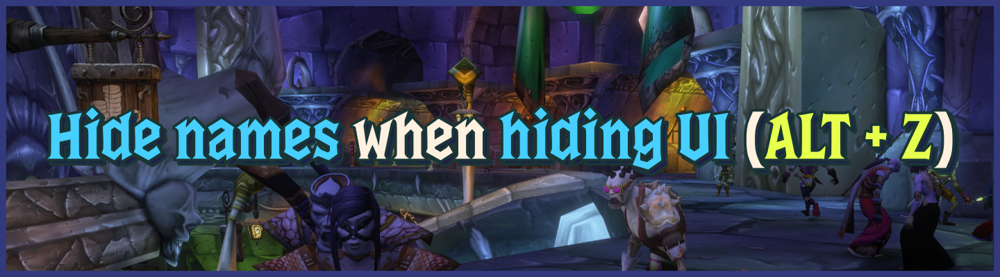
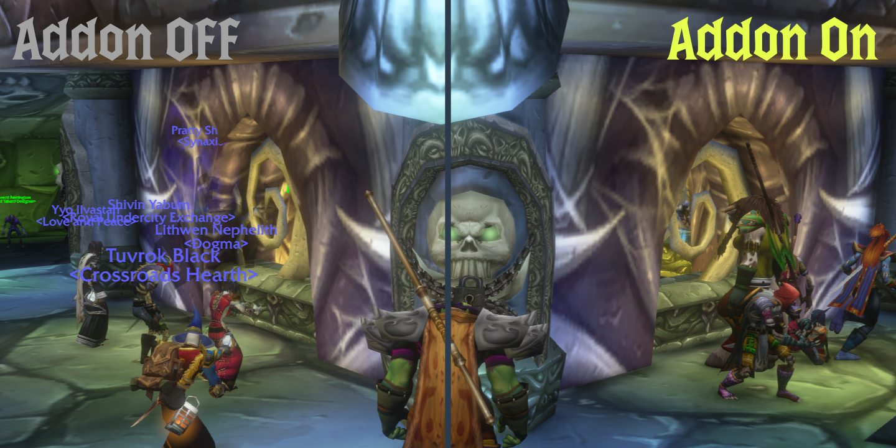
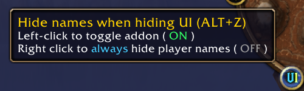

### **Supports WoW: Forever!**

Tired of creature and player names ruining your beautiful screenshots?

This simple addon hides these things away when you toggle your UI off (default ALT+Z)

### Minimap Button

Left clicking the minimap button toggles the addon's main hiding function on and off

Right-click to switch between **HIDE** and **SHOW** when the UI is hidden. SHOW uses your normal player name, guild, title and nameplate settings.

### Notes on dependency

CurseForge installs LibDBIcon separately for the minimap button.  
Manual ZIP users can install LibDBIcon themselves or use an embedded version provided by another add-on.  
Without the library, hiding names with Alt+Z still works, but the minimap button won't be there.
