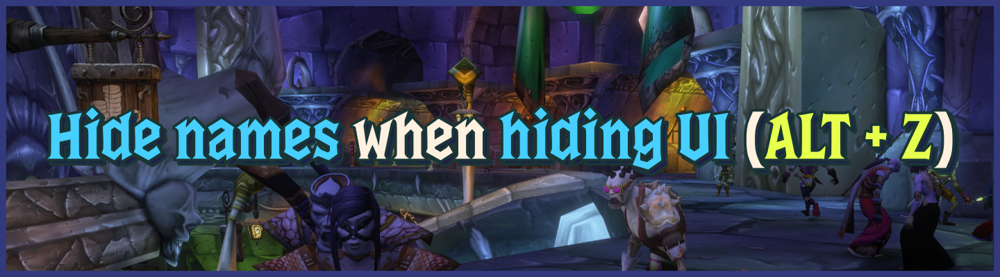
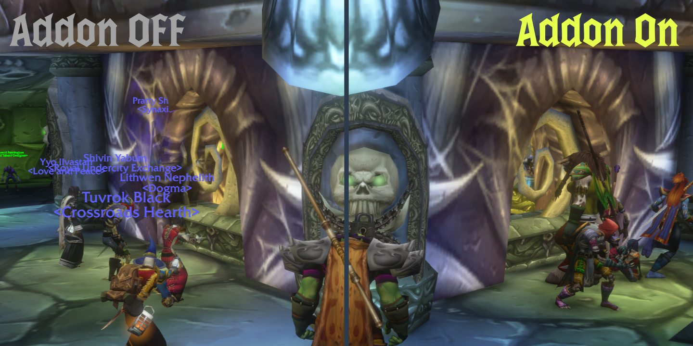
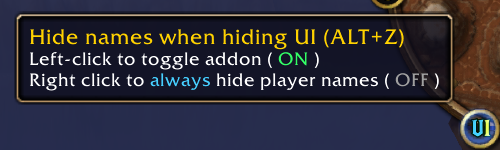

### **Supports WoW: Forever!**

Tired of creature and player names ruining your beautiful screenshots?

This simple addon hides these things away when you toggle your UI off (default ALT+Z)

### Bonus Feature

Left clicking the minimap button toggles the addon's main hiding function on and off  
Right clicking it toggles all player names on and off, even if you're not hiding the UI (OFF by default)

